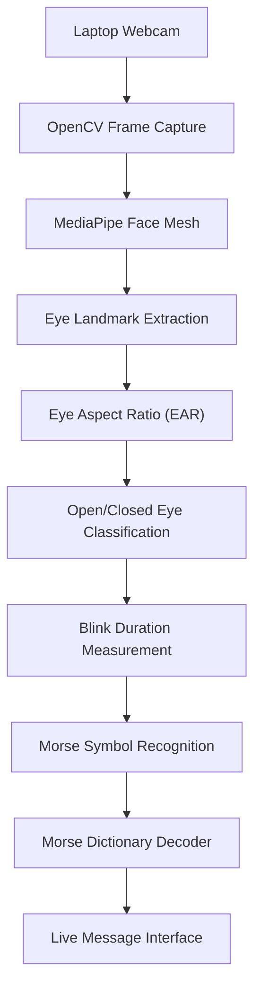

# 👁️ EyeCode — Eye-Based Morse Code Communication

**Communicate through intentional eye blinks. No keyboard required for sending Morse signals.**

EyeCode is a Python-based computer vision experiment that uses a laptop webcam to detect eye closures and translate their durations into Morse Code. It displays the detected signals and decoded messages in a real-time visual interface.

Built using Python, OpenCV, NumPy, and MediaPipe Face Mesh, EyeCode explores hands-free visual communication inspired by optical signalling systems.

> **Project status:** Experimental prototype — live face and eye landmark detection implemented; calibration and Morse decoding under development and testing.

---

## 📸 Project Preview


*Live EyeCode interface: face tracking, eye landmark visualisation, eye aspect ratio (EAR), calibration status, and Morse message display.*

## ✨ Features

- 👁️ **Real-time eye tracking** — detects facial landmarks using MediaPipe Face Mesh.
- 🎥 **Webcam-based operation** — works with a compatible laptop camera.
- 📐 **Eye Aspect Ratio (EAR)** — measures eye openness using facial landmark geometry.
- 🎯 **Two-stage calibration** — records open-eye and closed-eye measurements.
- 🔵 **Morse signal recognition** — classifies eye closures by duration as dots (`.`) or dashes (`-`).
- 🔤 **Morse decoding** — converts recognised sequences into letters, digits, and supported punctuation.
- 🖥️ **Live visual interface** — displays tracking status, measurements, Morse buffer, and decoded text.
- 🛠️ **Manual correction controls** — allows manual character commitment, deletion, and message reset.
- 🔒 **Local processing** — the application does not intentionally upload or save webcam footage.

## 🧠 How It Works

EyeCode uses the Eye Aspect Ratio (EAR) to estimate how open the eyes appear.

The application measures the vertical distance between eye landmarks relative to the horizontal eye width. When the measured ratio decreases sufficiently, the eyes may be classified as closed.

### System Architecture



### Communication Pipeline

1. **Capture:** OpenCV obtains frames from the webcam.
2. **Track:** MediaPipe estimates facial and eye landmarks.
3. **Measure:** EyeCode calculates the EAR for both eyes.
4. **Calibrate:** Open-eye and closed-eye measurements establish a detection threshold.
5. **Classify:** Intentional closures are classified according to their duration.
6. **Decode:** The recognised dots and dashes are mapped to Morse characters.
7. **Display:** The interface displays the Morse buffer and decoded message.

## 🔤 Morse Code Signalling

The prototype uses short and long eye closures to represent Morse symbols.

| Signal | Meaning |
|---|---|
| Short closure | Dot (`.`) |
| Longer closure | Dash (`-`) |
| Pause after a sequence | Letter boundary |
| Longer pause | Word boundary |

For example, the international distress signal **SOS** is:

```text
S = ...
O = ---
S = ...

SOS = ... --- ...
```

The duration thresholds are configurable in the source code and may need adjustment for different users, cameras, and lighting conditions.

## 🛠️ Technology Stack

| Technology | Purpose |
|---|---|
| Python 3.12 | Application logic |
| OpenCV | Webcam capture and visual interface |
| MediaPipe Face Mesh | Facial landmark detection |
| NumPy | Numerical calculations and landmark geometry |
| Morse Code | Symbol-to-character mapping |

## 💻 Installation

### Prerequisites

- Windows 10 or Windows 11
- Python 3.12.x, 64-bit
- A working webcam
- VS Code or PyCharm
- A well-lit environment

### 1. Clone the repository

```bash
git clone <YOUR_REPOSITORY_URL>
cd EyeCode
```

Alternatively, open the folder containing `eyecode.py` in your IDE.

### 2. Create a virtual environment

```powershell
py -3.12 -m venv .venv
.\.venv\Scripts\Activate.ps1
```

### 3. Install dependencies

The following versions match the legacy `mp.solutions.face_mesh` API used by the current prototype.

```powershell
python -m pip install --upgrade pip
python -m pip install mediapipe==0.10.21 opencv-python==4.10.0.84 numpy==1.26.4
```

### 4. Run EyeCode

```powershell
python eyecode.py
```

Allow webcam access if Windows requests permission.

## 🎮 Keyboard Controls

| Key | Action |
|---|---|
| `C` | Calibrate open eyes |
| `K` | Calibrate closed eyes |
| `SPACE` | Commit the current Morse sequence |
| `ENTER` | Insert a word boundary |
| `BACKSPACE` | Delete a symbol or character |
| `R` | Reset the message |
| `Q` / `ESC` | Exit the application |

## 🎯 Calibration Procedure

1. Sit in front of the webcam with both eyes visible.
2. Press `C` and look naturally at the camera for two seconds.
3. Wait for the open-eye baseline to be recorded.
4. Press `K` and gently close your eyes for two seconds.
5. Wait for the application to calculate the detection threshold.
6. Test short and long closures and observe the EAR measurement.
7. Adjust the timing parameters if the signals are classified incorrectly.

Calibration quality depends on reliable landmark tracking and sufficient separation between open-eye and closed-eye measurements.

## 📁 Project Structure

```text
EyeCode/
├── eyecode.py
├── README.md
├── assets/
│   └── eyecode-dashboard.png
└── .venv/
```

The virtual environment should remain local and should not be committed to Git.

Add the following to `.gitignore`:

```gitignore
.venv/
.venv*/
__pycache__/
*.py[cod]
.idea/
.vscode/
```

## 🚧 Current Limitations

- Natural blinking may be mistaken for an intentional Morse signal.
- Face tracking may become unreliable with poor lighting, head movement, reflections on glasses, or partially obscured eyes.
- Calibration is sensitive to camera position and individual eye geometry.
- Timing-based signalling can be slow and error-prone.
- The current prototype has not been validated for medical, emergency, or operational use.
- Morse Code is an encoding method, not encryption.

## 🗺️ Future Roadmap

- [ ] Improve face-tracking recovery and calibration feedback.
- [ ] Add an explicit activation mode to reduce accidental signals.
- [ ] Add configurable blink-duration thresholds.
- [ ] Improve letter and word boundary detection.
- [ ] Add a visual Morse timeline and event log.
- [ ] Measure false-positive and missed-signal rates.
- [ ] Add optional text-to-speech output.
- [ ] Explore communication between two devices.
- [ ] Evaluate performance across different lighting conditions and users.

## 🔬 Project Objective

EyeCode explores whether ordinary webcam-based computer vision can support hands-free Morse signalling. It is intended as an experimental learning project in computer vision, human-computer interaction, and alternative communication interfaces.

## ⚠️ Disclaimer

EyeCode is an experimental prototype. It is not a secure, encrypted, military-grade, or safety-critical communication system. Do not rely on it for emergencies or operational signalling.

## 📜 License

This project is released under the MIT License. Add a `LICENSE` file containing the MIT License text before distributing the project under that license.
